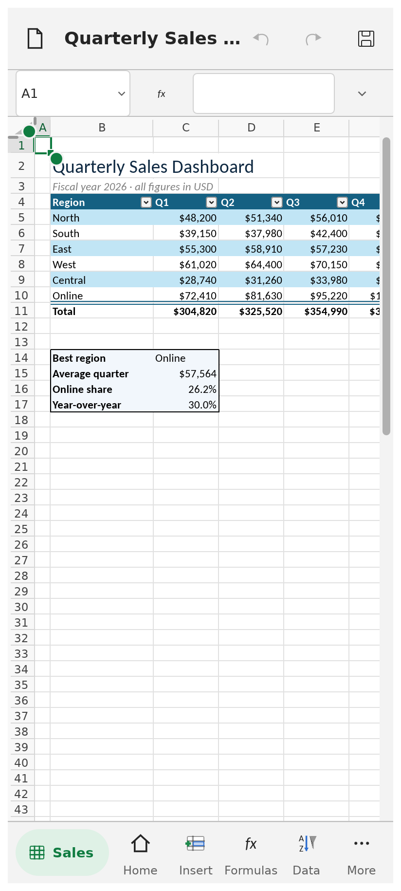
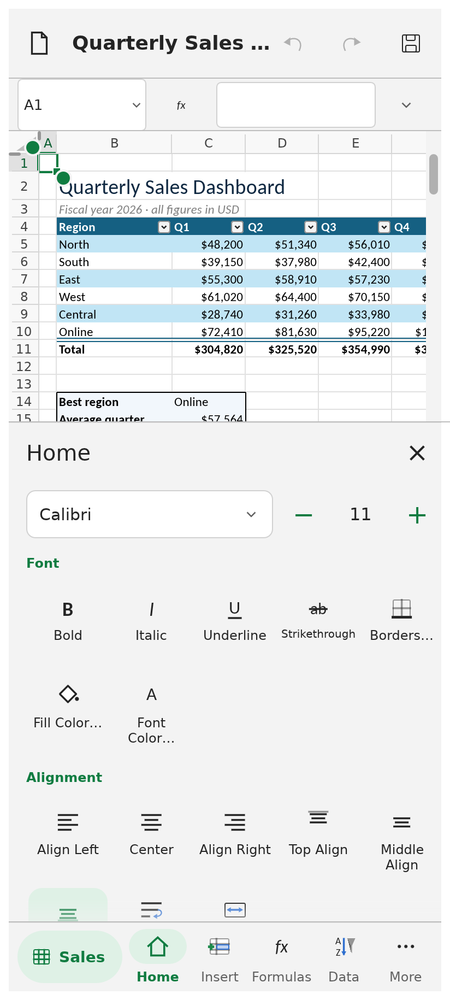
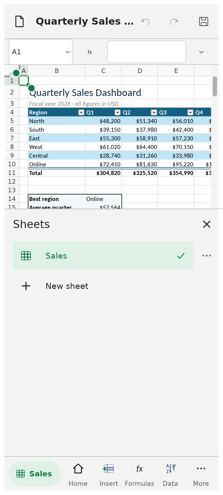
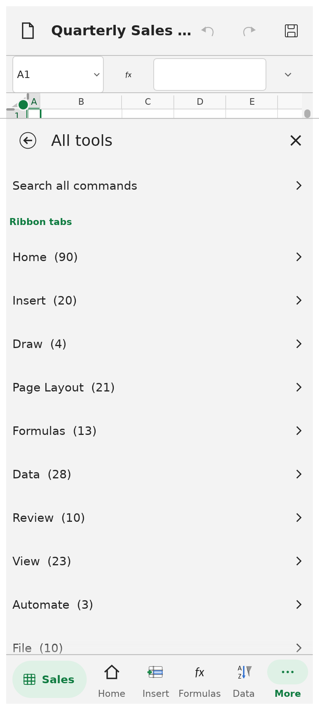
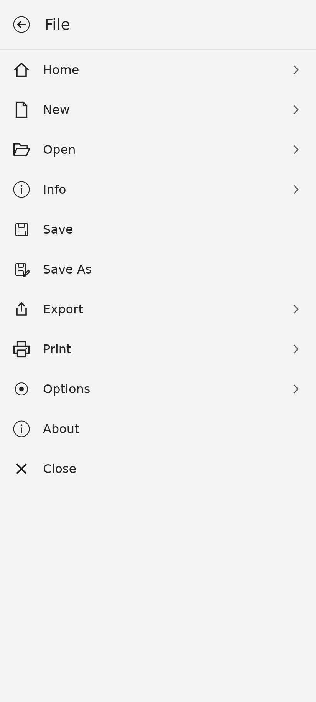
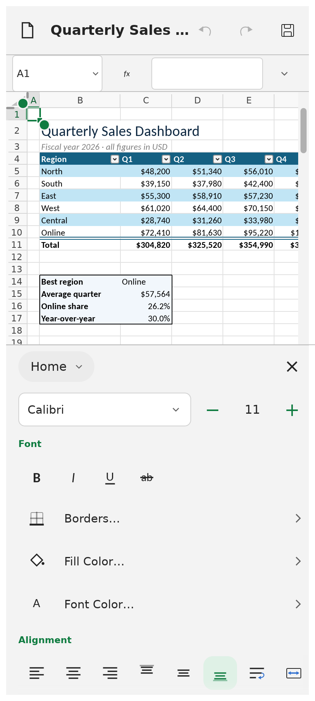
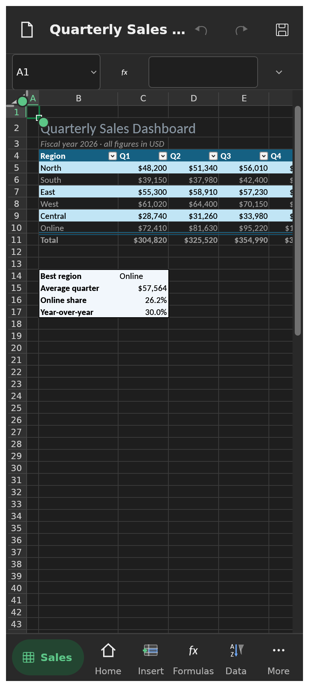

# Custom GridCraft for Android

> [!WARNING]
> **This project is made entirely by AI.** All of the code, notes and documentation in this
> repository's Android work were written by AI coding agents (Anthropic's Claude models), directed
> by a person who did not write or review the code line by line. It has not had human code
> review or security review, and has only been tried on an Android emulator. Expect bugs. Do not
> trust it with spreadsheets you can't afford to lose.

> [!IMPORTANT]
> **This is an unofficial, personal fork. It is not made, endorsed or supported by the ArtCraft
> team or by storytold.** It is not the official GridCraft, and it is not an ArtCraft project.
> Please don't report problems with this fork to the original project.

## Screenshots

<p>      </p>

## What this is

**In short: a phone interface for Android on top of the GridCraft spreadsheet engine.**
[GridCraft](https://github.com/storytold/gridcraft) is an open-source Rust spreadsheet by the
ArtCraft team. Everything that makes it a spreadsheet (the workbook model, formulas and functions,
recalculation, charts, .xlsx and other file formats, rendering) is the original GridCraft engine.
This fork adds a touch layout around it and the Android plumbing to host it as a **native app**
(no WebView): a GameActivity with Kotlin bridges for the keyboard, the system file picker and the
clipboard.

It is a sister project of
[Custom WordCraft for Android](https://github.com/Murdock011/custom-wordcraft-android), built the
same way. Changes below the interface are listed in
[docs/ENGINE-CHANGES.md](docs/ENGINE-CHANGES.md) (none so far). It is currently based on GridCraft
engine **0.19.1**.

## Download

There is no release yet. The app is in early development and is only built for the emulator so
far. When a release is made it will be on the
[Releases page](https://github.com/Murdock011/custom-gridcraft-android/releases). It installs as
`ai.storyteller.gridcraft.native`, next to any other GridCraft or WordCraft build.

## What works

- The full GridCraft grid on a phone: tapping cells, typing values and formulas, the formula bar
  and a sheet button, the first slot of the tab bar, that opens a list of sheets (switch, add,
  rename, duplicate, delete).
- A phone layout instead of the desktop ribbon: an app bar with File, the workbook name, Undo, Redo
  and Save, and a fixed tab bar at the bottom (the sheet button, Home, Insert, Formulas, Data,
  More) whose tabs open bottom sheets of touch-sized tiles above it, grouped in sections (Home has
  font, size, alignment, number, clipboard, cells, styles and editing). Tapping the open tab again
  closes its sheet; View, Page Layout and Review are in More. More also has Search and All tools:
  every command of the engine by ribbon tab, so nothing on the desktop ribbon is out of reach.
- File › Options › General › Phone layout switches the sheets to a List style: no tab bar, a
  floating quick bar (sheet button, Bold, Fill Color, AutoSum, Sort A to Z, More), a tab menu at
  the top of the sheet, and one command per row. Theme there is Light (the default), Dark (the
  grid too) or System. Back closes an open sheet. The layout follows the
  shared phone plan for the Craft apps; more of it is still to come.
- Saving through the Android system save dialog (Save As), and saving back to a workbook opened
  from the file picker. The unsaved-changes dot clears after a successful save.
- Opening spreadsheets through the system file picker (.xlsx, .xlsm, .xls, .xlsb, .ods, .csv,
  .txt). Not yet tested on a device.
- Bold text, and typing with the on-screen keyboard (checked on the emulator).
- Touch editing: one tap selects a cell, a double tap (or the formula bar) edits it, with large
  cancel and confirm buttons above the keyboard; the edited cell stays visible.
- Unsaved work survives Android closing the app in the background: a recovery copy is kept
  while you work and reopened on the next launch with a "Recovered unsaved changes" message.
- Selection handles to drag a range, and a long-press action bar (Cut, Copy, Paste, Clear, and
  More for Fill Down, Insert and Delete).
- Dialogs and messages as bottom sheets with large buttons pinned at the bottom.
- A full-screen File menu (Home, New, Open, Info, Save, Save As, Export, Print, Options, About,
  Close); Close and Back ask before discarding unsaved changes. The File pages and Options open as
  full-screen phone pages in one column (Options: a category list, on/off settings as switches);
  Back from a page returns to the File menu. Print saves a PDF to print from a PDF viewer. With
  several workbooks open, the File menu lists them first, to switch between or close.

## Known gaps

- Pinch to zoom is built and tested in code, but not yet tried with real fingers on a device.
- Not yet tried on a real phone.

Work in progress is logged step by step in [notes/native-port.md](notes/native-port.md).

## What this fork adds

- `apps/gridcraft-android/`: the native Android host (Rust).
- `packaging/android-native/`: the Gradle project, `build-native.sh` and the app icon.
- `crates/ui-egui/src/phone.rs` and small hooks across `crates/ui-egui`: the phone layout. They only
  apply on narrow screens; the desktop layout is unchanged.
- `notes/native-port.md`: what was done, update by update.

## Building

Needs the Android SDK and NDK 27, `cargo-ndk`, and the Rust Android targets.

```sh
rustup target add aarch64-linux-android x86_64-linux-android
cargo install cargo-ndk
sh packaging/android-native/build-native.sh x86_64         # emulator
sh packaging/android-native/build-native.sh arm64-v8a      # phone
```

The debug APK is written to `packaging/android-native/app/build/outputs/apk/debug/`.

## Updating the engine

The fork keeps the original project's full history, so a newer GridCraft version comes in with an
ordinary `git merge` of its release tag. Conflicts can only be in the files this fork changed
(see above and [docs/ENGINE-CHANGES.md](docs/ENGINE-CHANGES.md)); keep upstream's change and
re-apply this fork's on top.

## Credit and licence

All of GridCraft itself, the spreadsheet engine, formulas, file formats and desktop interface, is
the work of the ArtCraft team and the GridCraft contributors. This fork keeps their licence:
MIT OR Apache-2.0, at your option ([LICENSE-MIT](LICENSE-MIT), [LICENSE-APACHE](LICENSE-APACHE)).
Asset credits are in [ATTRIBUTION.md](ATTRIBUTION.md). The app icon includes the Android robot,
reproduced or modified from work created and shared by Google and used according to terms
described in the Creative Commons 3.0 Attribution License. The original project's README is kept in
[docs/UPSTREAM-README.md](docs/UPSTREAM-README.md).

Names, logos and branding of GridCraft and ArtCraft belong to their owners; their use here only
identifies where the code came from.
